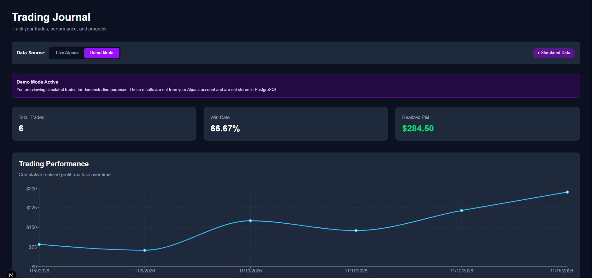
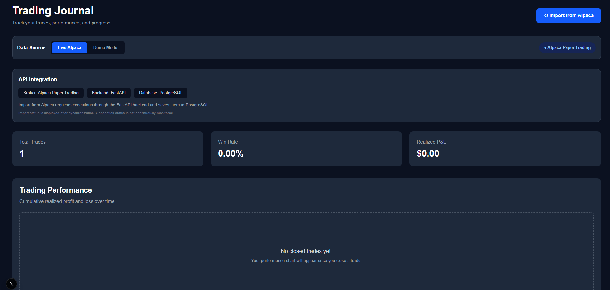
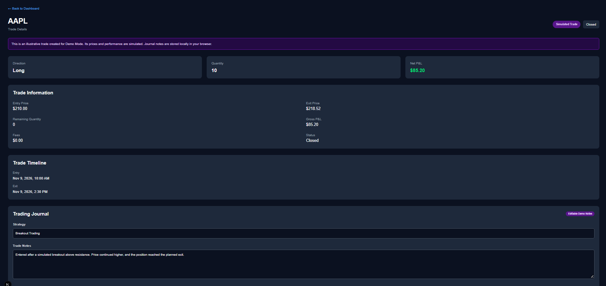

# Trading Journal

A full-stack trading journal application built with Next.js, TypeScript, FastAPI, and PostgreSQL.

The application integrates with the Alpaca Paper Trading API to automatically import trading executions, track trading activity, and visualize performance.

It also includes an interactive Demo Mode, allowing users to explore trading analytics and journal features without connecting to a brokerage account.

## Screenshots

### Demo Dashboard

The interactive demo dashboard displays simulated trades, win rate, realized profit/loss, and cumulative trading performance.



### Alpaca API Integration

The Live Alpaca dashboard connects to a Python FastAPI backend, which retrieves trading data from Alpaca and stores execution records in PostgreSQL.



### Trade Details and Editable Journal

Users can explore individual trades, review entry and exit information, and document trading strategies, notes, and lessons learned.



---

## Features

### Trading Dashboard

- View trading activity and performance statistics
- Track total trades, win rate, and realized profit/loss
- Visualize cumulative P&L using interactive Recharts graphs
- View trade history with entry and exit prices
- Navigate to individual trade details

### Alpaca API Integration

- Connect to the Alpaca Paper Trading API
- Retrieve trading executions using REST API requests
- Synchronize execution records into PostgreSQL
- Prevent duplicate imports using unique database constraints
- Preserve execution quantities with decimal precision
- Apply FIFO-based trade matching logic

### Trade Details

- View entry and exit prices
- Track trade quantities and position status
- Display gross and net profit/loss
- Review execution timestamps
- Navigate between the dashboard and individual trades

### Interactive Demo Mode

- Switch between Live Alpaca and Demo Mode
- Explore six simulated stock trades
- View simulated performance analytics
- Display interactive cumulative P&L charts
- Open individual simulated trades
- Edit trading strategies and journal notes
- Save and reset notes using browser local storage
- Demonstrate application features without running the backend

Demo Mode is clearly labeled and remains separate from broker-sourced trading data.

### Trading Journal

The journal provides fields for:

- Trading strategy
- Trade notes
- Lessons learned

In Demo Mode, users can edit and save these fields. Notes are stored locally in the browser and remain available after refreshing the page.

## Technology Stack

| Component | Technology |
|-----------|------------|
| Frontend | Next.js, React, TypeScript |
| Styling | Tailwind CSS |
| Charts | Recharts |
| Backend | Python, FastAPI |
| Database | PostgreSQL |
| ORM | SQLAlchemy |
| Database Migrations | Alembic |
| External API | Alpaca Paper Trading REST API |
| Version Control | Git, GitHub |

## System Architecture

```text
                  Next.js Frontend
                         |
                         | HTTP / JSON
                         |
                         v
                   FastAPI Backend
                         |
              +----------+----------+
              |                     |
              v                     v
        PostgreSQL Database    Alpaca Trading API
              |
        Trade Records
        Execution History
        Trading Analytics


                  Demo Mode
                      |
                      v
              Simulated Trade Data
                      |
                      v
              Browser Local Storage
                 (Journal Notes)
```

### How It Works

1. The Next.js frontend sends HTTP requests to the FastAPI backend.
2. FastAPI communicates with Alpaca's Paper Trading API.
3. Alpaca returns trading execution information.
4. SQLAlchemy stores the execution records in PostgreSQL.
5. The backend exposes endpoints for trades and analytics.
6. The frontend displays trading activity, performance statistics, and trade details.

Demo Mode operates independently using simulated frontend data and browser local storage.

## Project Structure

```text
trading-journal/
|
|-- backend/
|   |-- app/
|   |   |-- adapters/
|   |   |-- api/
|   |   |-- core/
|   |   |-- models/
|   |   |-- services/
|   |-- alembic/
|   |-- requirements.txt
|   |-- .env.example
|
|-- frontend/
|   |-- src/
|   |   |-- app/
|   |   |   |-- page.tsx
|   |   |   |-- trades/
|   |   |       |-- [tradeId]/
|   |   |           |-- page.tsx
|   |   |-- components/
|   |       |-- PerformanceChart.tsx
|   |       |-- DemoJournalEditor.tsx
|   |-- package.json
|
|-- docs/
|   |-- screenshots/
|       |-- dashboard.png
|       |-- alpaca-integration.png
|       |-- trade-details.png
|
|-- .gitignore
|-- README.md
```

## Getting Started

### Prerequisites

- Python 3
- Node.js and npm
- PostgreSQL
- Git
- Alpaca Paper Trading account (for broker integration)

### 1. Clone the Repository

```bash
git clone https://github.com/takwami0919/trading-journal.git
cd trading-journal
```

### 2. Backend Setup

Navigate to the backend folder:

```bash
cd backend
```

Create a Python virtual environment:

```bash
python -m venv .venv
```

Activate the environment on Windows PowerShell:

```powershell
.\.venv\Scripts\Activate.ps1
```

Install Python dependencies:

```bash
python -m pip install -r requirements.txt
```

### 3. Configure Environment Variables

Create a `.env` file inside the `backend` folder using `.env.example` as a template.

Configure:

- PostgreSQL database connection
- Application secret keys
- Credential encryption key
- Alpaca Paper Trading credentials

Do not commit real credentials or secret keys to GitHub.

### 4. Run Database Migrations

Make sure PostgreSQL is running and your database connection is configured.

Run:

```bash
python -m alembic upgrade head
```

### 5. Start the Backend

```bash
python -m uvicorn app.main:app --reload
```

Backend API:

http://127.0.0.1:8000

Interactive FastAPI documentation:

http://127.0.0.1:8000/docs

### 6. Start the Frontend

Open another terminal.

From the project root:

```bash
cd frontend
npm install
npm run dev
```

Open the application:

http://localhost:3000

## Demo Mode

Demo Mode can be used without running PostgreSQL or FastAPI.

Start the Next.js frontend and visit:

http://localhost:3000/?mode=demo

The demo includes:

- Six simulated trades
- Trading statistics
- Interactive performance chart
- Individual trade-details pages
- Editable journal notes
- Browser-based note persistence

Click any simulated trade symbol to open its details page.

For example:

http://localhost:3000/trades/demo-1

Edit the strategy, trade notes, or lessons learned, then click **Save Notes**.

Notes are saved in the browser using local storage.

## REST API Endpoints

The backend exposes several REST API endpoints:

| Method | Endpoint | Description |
|--------|----------|-------------|
| GET | `/trades/` | Retrieve trading history |
| GET | `/trades/{trade_id}` | Retrieve individual trade details |
| GET | `/executions/` | Retrieve imported executions |
| POST | `/executions/sync` | Synchronize Alpaca executions |
| GET | `/analytics/summary` | Retrieve trading statistics |
| GET | `/analytics/performance` | Retrieve performance chart data |

### Example API Response

A trading execution may be represented as:

```json
{
  "symbol": "AAPL",
  "side": "buy",
  "quantity": 10,
  "price": 210.00
}
```

The frontend requests data from these endpoints and displays the information in the dashboard.

## Database Design

The PostgreSQL database contains models for:

- Users
- Broker connections
- Trading executions
- Trades
- Trading strategies
- Trade notes
- Trade screenshots

SQLAlchemy provides database interaction, while Alembic manages schema migrations.

Trading executions use broker-specific identifiers to help prevent duplicates during repeated imports.

## Current Development Status

### Implemented

- Full-stack frontend and backend
- PostgreSQL integration
- Alpaca Paper Trading execution imports
- REST API endpoints
- Trading dashboard
- Interactive performance chart
- Trade history and trade-details pages
- Demo Mode with simulated trading data
- Editable and persistent demo journal notes
- Database migrations

### Planned Improvements

- Complete cryptocurrency fee reconciliation
- Improve live closed-trade detection
- Support partial position closures
- Complete fee-adjusted realized P&L calculations
- Support persistent journal editing for live trades
- Add additional trading analytics
- Deploy the application for public demonstrations

Live Alpaca execution import is implemented. Some advanced trade-accounting features, including cryptocurrency fee reconciliation and partial closures, remain under development.

## Security

- Sensitive configuration is stored in environment variables.
- Local `.env` files are excluded from Git.
- Broker credentials are encrypted when stored by the backend.
- Demo Mode does not modify brokerage records.
- Demo trading results are clearly identified as simulated.

The current backend is intended for local development and is not configured as a production-ready multiuser service. Authentication and endpoint authorization should be completed before exposing the backend publicly.

## Disclaimer

This project is intended for educational and portfolio demonstration purposes.

Demo trades and their performance results are simulated and do not represent actual investment returns.

The application is not intended to provide financial or investment advice.
